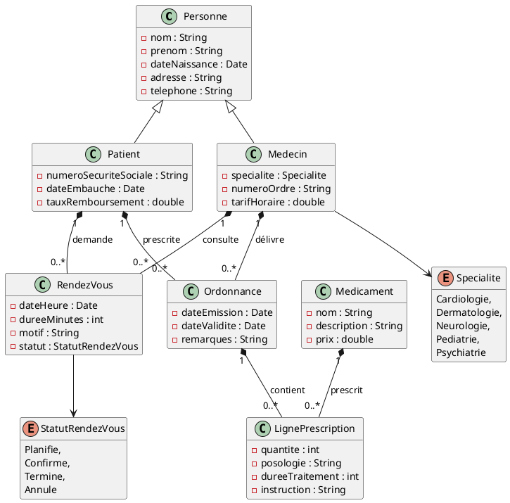

# Application de gestion d'un cabinet médical

## Description du projet et des fonctionnalités implémentées

**Ce projet nous permet de faire un application pour un cabinet médical.
Fonctionnalités implémentées :
  - Affichage de la liste des patients
  - Ajout d'un patient
  - Affichage de la liste des médecins
  - Ajout d'un médecin 
  - Affichage de la liste des médicaments
  - Ajout d'un médicament 
  - Affichage de la liste des rendez-vous
  - Ajout d'un rendez-vous
  - Affichage de la liste des médicaments
  - Ajout d'une ordonnance 
  - Le code respecte le découpage Modèle Vue Contrôleur
  - Le calcul des montants des rendez-vous est correct
  - Le calcul des montants des ordonnances est correct
  - Le code est correctement documenté avec la Javadoc
  - Le projet utilise des loggers 
  - Des mocks sont utilisés dans les tests lorsque c'est nécessaire
  - Création de tickets 
  -  Ajout des dépendances nécessaires dans le fichier build.gradle
  - Ajout d'un fichier de configuration log4j.xml pour le logger dans le dossier src/main/resources
  - Modification de la classe Statistiques
  - Modification et correction de la classe Recherche 
  - Ajout de la fonction double getPrixTotal() dans la classe Ordonnance
  - Ajout de la fonction prixConsultation()  dans la classe RendezVous
  - Modification du fichier build.gradle, et ajout des dépendances pour l'utilisation de JUnit 5, JUnit Platform, AssertJ pour les assertions et Mockito pour les mocks
  - Ajout de Test Unitaire pour les classes Ordonnance, RendezVous, Patient, Medecin, Medicament, LignePrescription
  - Ajout d'une documentation JavaDoc 
  - Organisation des différentes classes de l’application pour qu’elles respectent le découpage Modèle‑Vue‑Contrôleur.
  - Ajout vue Gestion Patients
  - Ajout vue Accueil
  - Ajout Vue Gestion Medecin
  - Ajout Vue Rendez-vous
  - Ajout Vue Liste des patients
  - Ajout Vue concernant l'ajout d'un patient
  - 

**

## Membres du groupe

**BARLOY Thomas
  BEAUVAIS Maxence
  DUBREUCQ Kévin
  VANSTRACEELE Lucas**

## Répartition du travail

**TABLEAU À COMPLÉTER**

| Membre du groupe | Tâches réalisées                             | Ticket associé |
|------------------|----------------------------------------------|----------------|
| VANSTRACEELE Lucas| Dépendance gradle logger                    | #1             |
| BEAUVAIS Maxence  | Fichier de configuration log4j.xml          | #2             |
| DUBREUCQ Kévin    | Remplacement des SOP par des logger         | #3             |
| BARLOY Thomas     | Refactoriser la classe Statistiques         | #4             |
| BEAUVAIS Maxence  | Refactoriser la classe Recherche            | #5             |
| BEAUVAIS Maxence  | Fonction double getPrixTotal                | #6             |
| VANSTRACEELE Lucas| Fonction PrixConsulation()                  | #7             |
| BEAUVAIS Maxence  | Dépendances gradle JUnit 5                  | #8             |
| BEAUVAIS Maxence  | Tests unitaire de la classe médicament      | #9             |
| DUBREUCQ Kévin    | Compléter les tests Unitaire                | #11            |
| DUBREUCQ Kévin    | Documentation JavaDoc                       | #12            |
| DUBREUCQ Kévin    | Tests Unitaire de la classe Recherche       | #13            |
| VANSTRACEELE Lucas| Tests Unitaire de la classe GestionPatients | #14            |
| BARLOY Thomas     | Tests Unitaire de la classe Ordonnance      | #15            |
| BEAUVAIS Maxence  | Organistaion modele MVC                     | #18            |

## Présentation du code de base

### Diagramme des classes du modèle

### Diagramme des classes "services"

```plantuml
@startuml

top to bottom direction


class GestionMedecins {
  - medecins: List<Medecin>
  + rechercherParSpecialite(Specialite): List<Medecin>
  + ajouterMedecin(Medecin): void
  + rechercherParId(int): Medecin
  + mettreAJourMedecin(int, String, String, double, String, String, Specialite): void
  + getNombreMedecins(): int
  + afficherTousLesMedecins(): void
  + rechercherParNumeroOrdre(String): Medecin
  + listerTousLesMedecins(): List<Medecin>
  + rechercherParNom(String): List<Medecin>
  + supprimerMedecin(int): boolean
}
class GestionMedicaments {
  - medicaments: List<Medicament>
  + rechercherParId(int): Medicament
  + supprimerMedicament(int): boolean
  + ajouterMedicament(Medicament): void
  + listerTousLesMedicaments(): List<Medicament>
  + afficherTousLesMedicaments(): void
  + rechercherParNom(String): List<Medicament>
  + getNombreMedicaments(): int
}
class GestionOrdonnances {
  - ordonnances: List<Ordonnance>
  + listerToutesLesOrdonnances(): List<Ordonnance>
  + ajouterPrescription(int, Medicament, int, String, int, String): void
  + creerOrdonnance(Medecin, Patient, LocalDate, String): Ordonnance
  + getOrdonnancesMedecin(Medecin): List<Ordonnance>
  + getOrdonnancesValides(): List<Ordonnance>
  + getOrdonnancesPatient(Patient): List<Ordonnance>
  + afficherToutesLesOrdonnances(): void
  + rechercherParId(int): Ordonnance
  + getNombreOrdonnances(): int
}
class GestionPatients {
  - patients: List<Patient>
  + rechercherParNumeroSecu(String): Patient
  + mettreAJourPatient(int, String, String, String, String, String, double): void
  + afficherTousLesPatients(): void
  + supprimerPatient(int): void
  + ajouterPatient(Patient): void
  + listerTousLesPatients(): List<Patient>
  + rechercherParId(int): Patient
  + getNombrePatients(): int
  + rechercherParNom(String): List<Patient>
}
class GestionRendezVous {
  - rendezVous: List<RendezVous>
  + prendreRendezVous(Patient, Medecin, LocalDateTime, int, String): RendezVous
  + confirmerRendezVous(int): void
  + getRendezVousParStatut(StatutRendezVous): List<RendezVous>
  + terminerRendezVous(int): boolean
  + getRendezVousPatient(Patient): List<RendezVous>
  + rechercherParId(int): RendezVous
  + annulerRendezVous(int): void
  + getRendezVousMedecin(Medecin): List<RendezVous>
  + estDisponible(Medecin, LocalDateTime): boolean
  + getNombreRendezVous(): int
  + afficherTousLesRendezVous(): void
  + listerTousLesRendezVous(): List<RendezVous>
}
class Main {
  + main(String[]): void
}


Main                -[#595959,dashed]->  GestionMedecins    : "«create»"
Main                -[#595959,dashed]->  GestionMedicaments : "«create»"
Main                -[#595959,dashed]->  GestionOrdonnances : "«create»"
Main                -[#595959,dashed]->  GestionPatients    : "«create»"
Main                -[#595959,dashed]->  GestionRendezVous  : "«create»"
@enduml
```

